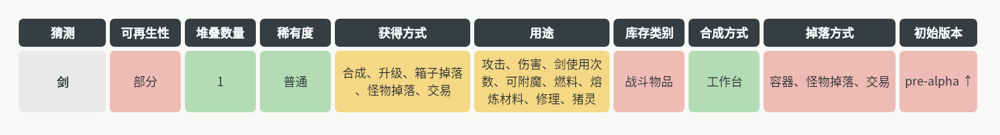

# 我的世界物品分类筛选器编写要求

下面你要编写一个能检索我的世界中的物品的html网页，要求如下：

## 数据来源与获取

你的筛选器中的所有信息必须来自于我的世界中文维基物品分类页面([zh.minecraft.wiki](https://zh.minecraft.wiki/w/%E7%89%A9%E5%93%81))，找到物品列表，通过物品列表后面的超链接进入物品详细页面，记录下每个物品的以下信息（下面以物品列表的第一条“船”（[1](https://zh.minecraft.wiki/w/%E8%88%B9)）为例），并在这些组的下面创建对应的tag赋予相应的物品，便于后面筛选和检索。若有多个物品的超链接指向相同的详情页，则将他们合并成一个物品。（注意：每个分类的tag都应该独立）

1、名称（这个分类不加tag，直接记录名称）

一般是这个页面的标题。若有多个物品的超链接指向相同的详情页，合并的这一个物品的名称应为这个详情页的标题。例如金合欢木船和橡木船都指向“船”这个详情页，那么它们合并的这个物品的名称就应该叫“船”。

2、可再生性

可再生有是、部分、否三种类别。这里船的可再生性是“是”，那么就给船这个物品的“可再生性”这一信息打上“是”的tag。

3、堆叠数量

就是这个物品的最大堆叠数量。同样，船的堆叠数量是一，那就打上一个“1”的tag。

4、稀有度

在[这个页面](https://zh.minecraft.wiki/w/%E7%A8%80%E6%9C%89%E5%BA%A6)调查它的稀有度，依旧稀有度是什么就打什么tag。船的稀有度是普通，就打普通tag。

5、获得方式

在“获取”这个子章节获得相关信息。主要找加粗的小标题。例如船只有一个合成获得途径，那就只给船打上“合成”的tag

6、用途

在“用途”这个子章节获得相关信息。主要找加粗的小标题。船的用途有三种，分别是“合成材料”“交易”“燃料”

7、库存类别

在创造标签页（JE）这里找到信息。船的是“工具与实用物品”。

8、合成方式

在“获取”子章节中的“合成”子子章节寻找，如果是工作台合成就写工作台，如果是熔炉合成就写熔炉。船只能用工作台合成，所以tag就是“工作台”。

9、掉落方式

找“获取”子章节中可以使其以掉落物形式掉在地上的获取方式。“剑”的方式有三种，生物、箱子战利品、交易，所以给它打这三个tag。

10、初始版本

这个物品首次被添加进游戏的版本。在历史-Java版底下找到最早被加入游戏的版本。如果在alpha版本以前统一归类为“pre-alpha”。剑是indev版本加入的，所以应该是pre-alpha。

## 最终展示样式

最终应该展示为表格形式，如图所示：

底部统一用白底，字体颜色统一调成黑色。
这里只展示了剑的信息，但是默认情况下页面应该展示所有物品的信息。
### 筛选功能 

在表头应该有一个下拉框，点开后出现一个包含所有tag的复选框界面，用户可以点击相应tag的复选框来检索含有对应tag的物品。“名称”一行应手动输入名字，进行模糊匹配。

## 简单例子
例如下面这个例子（我会在tag前加#表示这是一个tag）：

有1、2、3三个物品，他们的信息如下：

1：

名称：1

可再生性：#是

堆叠数量：#1

稀有度：#普通

获得方式：#qqq

用途：#sadf、#asefdsa

库存类别：#rwre

合成方式：#asdfa

掉落方式：#asdfa

初始版本：#1.0

2：

名称：2

可再生性：#是

堆叠数量：#1

稀有度：#普通

获得方式：#qqq、#24093

用途：#safdsf、#asefdsa

库存类别：#rwreasdf

合成方式：#asdfa

掉落方式：#afsdcxv、#rews

初始版本：#1.2

3：

名称：3

可再生性：#否

堆叠数量：#999

稀有度：#普通

获得方式：#qqqasv

用途：#saxcv、#asefdsa

库存类别：#rwr234

合成方式：#asdfcxv

掉落方式：#asdfa

初始版本：#1.0

那么，我要是点击“合成方式”的下拉框，勾选#asdfa标签，那么就只会显示1、2的信息。

## 远程链接

做好以后在主文件夹的"index"页面添加超链接和按钮。